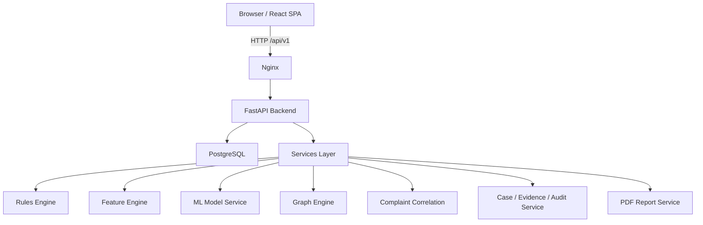

# MULEGUARD

**Intelligent Mule Account Detection and Financial Fraud Investigation Platform**

> **Prototype status:** MULEGUARD is a synthetic-first, academic / hackathon-grade prototype. It is **not production-ready**, does not connect to real banking systems, and does not process real customer data.

> **Safety statement:** Alerts, graph relationships, complaint associations, and risk scores are **investigative leads only**. They are not proof of wrongdoing. MULEGUARD must not be used for automatic account freezing, payment blocking, blacklisting, or any adverse customer action without appropriate human review.

---

## 1. What is MULEGUARD?

MULEGUARD helps fraud analysts investigate potentially suspicious bank-account behaviour by combining:

- transaction monitoring;
- behavioural feature extraction;
- rule-based detection;
- supervised and unsupervised machine-learning signals;
- graph analytics and candidate money-trail search;
- complaint correlation;
- evidence-backed explanations;
- investigation case management;
- audit history;
- PDF investigation reporting.

The goal is to let a reviewer complete the following workflow in one product:

1. Start the application from documented setup instructions.
2. Generate or load deterministic synthetic data.
3. Import and validate accounts, transactions, complaints, and entity relationships.
4. Run rules, feature extraction, anomaly scoring, model inference, and graph analysis.
5. View ranked alerts.
6. Open an account investigation profile.
7. Understand why the account was prioritised.
8. Inspect the exact transaction/evidence references behind each indicator.
9. Visualise the account’s local transaction network.
10. Explore bounded, time-ordered candidate money trails.
11. Correlate complaints with transaction references and related entities.
12. Create an investigation case from an alert.
13. Add evidence and notes.
14. Assign and update the case.
15. Review case history.
16. Generate a PDF report from persisted case data.
17. Review model and rules evaluation results, including limitations.

---

## 2. Core principles

MULEGUARD is built around these principles:

### Synthetic-first

The default dataset is deterministic synthetic data. No real customer data is required or expected.

### Evidence-backed

Risk indicators link to persisted transactions, complaints, accounts, graph paths, or rules that actually triggered.

### Explainable

The system exposes model version, scoring mode, feature values, triggered rules, and reasons. Scores are not presented as unsupported calibrated fraud probabilities.

### Human-in-the-loop

Investigators own case decisions. The model prioritises work; it does not adjudicate guilt.

### Auditability

Material case actions and privileged changes leave durable audit records.

### Reproducibility

Data generators, model training, evaluation, and tests support fixed random seeds.

### Temporal correctness

Point-in-time features and assessments use only information available at the time of assessment.

### Secure defaults

Inputs are validated, graph searches are bounded, SQL is parameterised, secrets are kept out of source control, and sensitive routes are protected.

### Graceful degradation

The system can run without a trained ML artifact, but it must explicitly identify its active fallback mode in the UI and API.

### No fake functionality

Buttons, filters, forms, charts, exports, and state transitions must do what their labels promise.

---

## 3. Explicit non-goals

MULEGUARD does **not**:

- connect to real bank systems;
- connect to real payment rails;
- process real customer accounts;
- access live cybercrime databases;
- perform deanonymisation;
- perform covert surveillance;
- implement automatic account freezing;
- implement automatic payment blocking;
- implement blacklisting;
- implement adverse automated customer actions;
- claim real-world fraud-detection accuracy;
- claim regulatory compliance.

---

## 4. Feature overview

### 4.1 Dashboard

The executive dashboard shows real backend-derived values, including:

- accounts analysed;
- transactions analysed;
- open alerts by priority;
- high-priority accounts;
- open cases by state;
- complaint counts and correlation counts;
- flagged transaction value;
- alert trend over time;
- risk-score distribution;
- recent alert/case activity.

If no data exists, the dashboard shows a useful empty state and a path to generate/load demo data.

### 4.2 Transaction monitoring

The transaction monitoring page supports:

- time, amount, sender, receiver, channel, and status filters;
- transaction ID/reference search;
- sortable, paginated results;
- transaction detail panel;
- sender/receiver profile navigation;
- evidence context showing why a transaction appears in an alert.

### 4.3 Account risk explorer

The account explorer supports:

- account search/filter/sort/pagination;
- investigative priority score and risk band;
- explicit disclosure that the score is not a probability of guilt;
- triggered indicators;
- latest activity;
- alert/case status;
- last assessment time;
- active scoring mode;
- role-permitted rerun of analysis.

### 4.4 Account investigation profile

Each account profile includes:

- synthetic account overview;
- score history / prior assessments;
- incoming and outgoing totals;
- windowed transaction volume;
- transaction timeline;
- risk indicator cards with measured values and thresholds;
- model version and scoring mode;
- graph/network summary;
- related complaints;
- connected cases and evidence.

Every risk reason should provide a path to inspect supporting records.

### 4.5 Graph investigation

The graph page uses Cytoscape.js to render real API data.

It supports:

- root account selection;
- bounded neighbourhood expansion;
- hop limits;
- time-window controls;
- amount controls where supported;
- node selection;
- edge selection;
- transaction detail panel;
- account detail side panel;
- path search;
- path highlighting;
- legend and edge-direction visibility;
- bounded result messaging;
- table/text alternatives for path evidence.

Graph proximity is never treated as proof of wrongdoing.

### 4.6 Complaint correlation

Complaint correlation supports transparent matching tiers:

1. exact transaction/reference match;
2. normalised identifier match;
3. account/entity association;
4. temporal graph association;
5. optional deterministic narrative extraction, when enabled.

Each correlation shows:

- complaint reference;
- reported time;
- category;
- matched transaction/account/entity;
- match tier;
- confidence or deterministic status;
- provenance;
- method;
- review state.

Exact matches are visually separated from inferred associations.

### 4.7 Alert queue

The alert queue supports:

- sorting by score/priority/age;
- filtering by status, rule, scoring mode, and time;
- inspection of triggered indicators;
- acknowledgement/triage where permitted;
- case creation from alert;
- duplicate open-alert prevention across repeated analysis runs.

### 4.8 Case management

Case management supports:

- searchable case list;
- manual case creation;
- case creation from alert;
- assignment/reassignment with permission checks;
- evidence attachment for accounts, transactions, complaints, alerts, graph paths, model assessments, and entity links;
- timestamped notes;
- priority/status updates;
- closure disposition;
- reopen with audit event;
- complete event history;
- case report generation.

Suggested case states:

```text
NEW → TRIAGED → UNDER_INVESTIGATION → ESCALATED → CLOSED
```

Closure dispositions may include:

```text
CONFIRMED_FRAUD
FALSE_POSITIVE
INCONCLUSIVE
REFERRED
```

These are investigator-entered assessments in the synthetic prototype, not automatic conclusions.

### 4.9 PDF reports

Reports are generated from persisted case and evidence data.

A report may include:

- title;
- case ID;
- generation timestamp;
- generated-by user;
- synthetic-data disclaimer;
- case state, priority, assignment, and disposition;
- executive summary;
- accounts/entities in scope;
- transaction timeline;
- candidate money-trail paths and constraints;
- complaint correlation table;
- risk assessment and contributing indicators;
- evidence reference index;
- investigator notes;
- case event history;
- limitations statement.

### 4.10 Model monitoring

The model monitoring page shows:

- active scoring mode;
- model version;
- latest training/evaluation run;
- computed metrics, if available;
- sample count;
- class distribution;
- split strategy;
- dataset fingerprint;
- threshold/score version;
- limitations statement.

If metrics are unavailable, the UI displays `Not evaluated` rather than fabricated values.

---

## 5. High-level architecture



MULEGUARD uses a modular monolith backend.

The database is the source of truth.

Graph analytics are derived from database records or bounded cached snapshots.

The frontend consumes typed backend APIs and does not act as the security boundary.

---

## 6. Technology stack

### Backend

- Python 3.11+
- FastAPI
- Pydantic
- SQLAlchemy 2.x
- Alembic
- PostgreSQL for Docker deployment
- SQLite for local development/tests where supported
- Pandas
- NumPy
- scikit-learn
- NetworkX
- ReportLab
- Pytest

### Frontend

- React
- TypeScript
- Vite
- React Router
- Tailwind CSS or equivalent consistent styling system
- Cytoscape.js
- Recharts
- TanStack Query or typed API client

### Operations

- Docker
- Docker Compose
- GitHub Actions CI
- Makefile / scripts
- environment-based configuration

---

## 7. Repository layout

```text
muleguard/
├── backend/                 # FastAPI backend, services, ML, rules, graph, tests
├── frontend/                # React/TypeScript analyst workstation
├── data/                    # synthetic generator docs, schemas, samples
├── docs/                    # architecture, API, security, model card, testing docs
├── scripts/                 # helper scripts for seeding, import, evaluation
├── .github/                 # CI workflows and templates
├── docker-compose.yml       # local Docker deployment
├── Makefile                 # common commands
├── .env.example             # safe environment template
├── CHANGELOG.md             # release history
├── CONTRIBUTING.md          # contribution rules
├── LICENSE                  # license
└── README.md                # this file
```

---

## Cloud deployment (Vercel + Render + Supabase)

For a hosted synthetic demo, see the step-by-step [Vercel, Render, and Supabase deployment guide](docs/deployment-vercel-render-supabase.md). It covers Vercel SPA rewrites, the Render FastAPI service, the Supabase PostgreSQL connection, environment variables, migrations, CORS, smoke tests, free-tier limitations, and the current first-admin provisioning blocker.

This stack deploys the frontend, backend, and database as separate services. Utility scripts such as data generation, schema checks, migrations, and demo seeding are one-off commands, not separate web services. MULEGUARD remains a synthetic-data prototype and must not be used with real customer or banking data.

## 8. Prerequisites

Before running MULEGUARD, install:

| Tool           | Minimum recommended version |
| -------------- | --------------------------: |
| Python         |                       3.11+ |
| Node.js        |                     20 LTS+ |
| npm            |                         10+ |
| Docker         |              current stable |
| Docker Compose |                         v2+ |
| Git            |              current stable |
| Make           |    optional but recommended |

For local non-Docker development, you may also install PostgreSQL 15+ locally.

---

## 9. Quick start with Docker Compose

This is the recommended end-to-end local path.

### 9.1 Clone the repository

```bash
git clone https://github.com/YOUR_ORG/muleguard.git
cd muleguard
```

### 9.2 Create environment file

Unix/macOS:

```bash
cp .env.example .env
```

Windows PowerShell:

```powershell
Copy-Item .env.example .env
```

### 9.3 Configure required secrets

Generate a strong backend secret:

```bash
openssl rand -hex 64
```

Update `.env`:

```dotenv
BACKEND_SECRET_KEY=YOUR_GENERATED_SECRET
POSTGRES_PASSWORD=YOUR_STRONG_POSTGRES_PASSWORD
```

If seeded development users are enabled, also configure development passwords:

```dotenv
DEV_ADMIN_PASSWORD=YOUR_DEV_ADMIN_PASSWORD
DEV_ANALYST_PASSWORD=YOUR_DEV_ANALYST_PASSWORD
DEV_SENIOR_INVESTIGATOR_PASSWORD=YOUR_DEV_SENIOR_PASSWORD
DEV_AUDITOR_PASSWORD=YOUR_DEV_AUDITOR_PASSWORD
```

Do not commit real secrets.

### 9.4 Build and start services

```bash
docker compose up --build
```

Default local URLs:

```text
Frontend:     http://localhost:8080
Backend API:  http://localhost:8000
Health:       http://localhost:8000/health
OpenAPI docs: http://localhost:8000/docs
```

If `SEED_DEMO_DATA=true`, the backend should seed the synthetic demo dataset during startup or through the documented seed command.

### 9.5 Stop services

```bash
docker compose down
```

### 9.6 Reset synthetic demo database

This is destructive.

```bash
make docker-reset
```

or:

```bash
docker compose down -v
```

Then start again:

```bash
docker compose up --build
```

---

## 10. Local development without Docker

Use this path when developing backend or frontend code directly.

### 10.1 Create Python virtual environment

Unix/macOS:

```bash
python -m venv .venv
source .venv/bin/activate
```

Windows PowerShell:

```powershell
python -m venv .venv
.venv\Scripts\Activate.ps1
```

### 10.2 Install backend dependencies

```bash
pip install -r backend/requirements-dev.txt
```

### 10.3 Install frontend dependencies

```bash
cd frontend
npm ci
cd ..
```

### 10.4 Create environment file

Unix/macOS:

```bash
cp .env.example .env
```

Windows PowerShell:

```powershell
Copy-Item .env.example .env
```

Configure `.env` values as described in the Environment configuration section.

### 10.5 Run database migrations

```bash
make migrate
```

or from `backend/`:

```bash
alembic upgrade head
```

### 10.6 Seed synthetic demo data

```bash
make seed
```

or use the documented Python generator command, for example:

```bash
python scripts/generate_data.py
```

### 10.7 Start backend

```bash
make dev-backend
```

or:

```bash
uvicorn backend.app.main:app --reload --port 8000
```

### 10.8 Start frontend

```bash
make dev-frontend
```

or:

```bash
cd frontend
npm run dev
```

The frontend development server usually runs at:

```text
http://localhost:5173
```

The backend usually runs at:

```text
http://localhost:8000
```

---

## 11. Environment configuration

Environment configuration is loaded from `.env` at the repository root.

Never commit `.env`.

The template file is:

```text
.env.example
```

Important variables:

| Variable                     | Purpose                                 |
| ---------------------------- | --------------------------------------- |
| `BACKEND_ENV`                | `local`, `staging`, or `production`     |
| `BACKEND_DEBUG`              | enable/disable debug mode               |
| `BACKEND_SECRET_KEY`         | authentication/signing secret           |
| `DATABASE_URL`               | SQLAlchemy database URL                 |
| `POSTGRES_HOST`              | PostgreSQL host                         |
| `POSTGRES_PORT`              | PostgreSQL port                         |
| `POSTGRES_DB`                | PostgreSQL database name                |
| `POSTGRES_USER`              | PostgreSQL user                         |
| `POSTGRES_PASSWORD`          | PostgreSQL password                     |
| `BACKEND_CORS_ORIGINS`       | allowed frontend origins                |
| `SEED_DEV_USERS`             | seed local development users            |
| `SEED_DEMO_DATA`             | seed synthetic demo data                |
| `SEED_RANDOM_SEED`           | deterministic synthetic seed            |
| `ML_ARTIFACT_DIR`            | controlled ML artifact directory        |
| `ML_REQUIRE_TRAINED_MODEL`   | require trained model or allow fallback |
| `VITE_API_BASE_URL`          | frontend API base URL                   |
| `VITE_SHOW_SYNTHETIC_BANNER` | show synthetic demo banner              |

For production-like environments:

```dotenv
BACKEND_ENV=production
BACKEND_DEBUG=false
BACKEND_OPENAPI_ENABLED=false
SEED_DEV_USERS=false
SEED_DEMO_DATA=false
AUTH_COOKIE_SECURE=true
```

---

## 12. Database migrations

Migrations use Alembic.

Apply migrations:

```bash
make migrate
```

or:

```bash
cd backend
alembic upgrade head
```

Create a new migration after changing models:

```bash
cd backend
alembic revision --autogenerate -m "describe change"
```

Always review autogenerated migrations before applying them.

---

## 13. Synthetic data generation

MULEGUARD is synthetic-first.

The deterministic generator creates:

- legitimate salary credits;
- utilities;
- person-to-person payments;
- regular merchant activity;
- recurring transfers;
- rapid pass-through scenarios;
- fan-in scenarios;
- fan-out scenarios;
- multi-hop layering;
- cycles / round-tripping;
- complaint-linked transactions;
- shared synthetic entity relationships;
- dormant-to-active accounts;
- high-velocity accounts;
- hard negatives.

Generate data using:

```bash
make seed
```

or:

```bash
python scripts/generate_data.py
```

A fixed seed should produce repeatable IDs, relationships, labels, and timestamps.

Example seed configuration variables:

```dotenv
SEED_RANDOM_SEED=42
SEED_ACCOUNTS=1200
SEED_TRANSACTIONS=25000
SEED_COMPLAINTS=150
SEED_FRAUD_SCENARIOS=12
```

Synthetic ground-truth labels are kept isolated and must not leak into model inputs.

---

## 14. Analysis workflow

After seeding data, run analysis:

```bash
make analyze
```

or through the authenticated API:

```http
POST /api/v1/analysis/run
```

Analysis performs:

- feature snapshot computation;
- rule evaluation;
- anomaly scoring;
- supervised model scoring when an artifact exists;
- graph-derived signal computation;
- complaint correlation refresh where applicable;
- risk fusion;
- alert generation or deduplication;
- explanation persistence;
- analysis-run state persistence.

If no trained model artifact exists, the active scoring mode should be explicitly labelled:

```text
heuristic_fallback
```

If a trained model is loaded, the scoring mode should be:

```text
trained_model
```

---

## 15. Model training and evaluation

Train a model from synthetic data:

```bash
make train-model
```

or from `backend/`:

```bash
python -m app.ml.train_model --seed 42
```

Evaluate the trained model:

```bash
make evaluate-model
```

or:

```bash
python scripts/evaluate_model.py
```

The training pipeline should:

1. retrieve/generate labelled synthetic accounts and features;
2. validate feature and label integrity;
3. create a reproducible split;
4. fit preprocessing only on the training partition;
5. fit the supervised model;
6. train the Isolation Forest anomaly detector;
7. evaluate on held-out data;
8. save artifacts and metadata;
9. print a readable metric report;
10. fail clearly on invalid or empty training data.

Metrics may include:

- precision;
- recall;
- F1;
- PR-AUC where supported;
- ROC-AUC as a supplementary metric;
- Precision@K / top-K review yield;
- confusion matrix;
- false-positive rate;
- latency estimate;
- undefined-metric notes where applicable.

Metrics are computed on synthetic data only.

Do not interpret them as real-world fraud-detection performance.

---

## 16. Authentication and roles

MULEGUARD includes role-based authentication for the demo.

Roles:

| Role                  | Purpose                                                                             |
| --------------------- | ----------------------------------------------------------------------------------- |
| `ADMIN`               | manage users/configuration and permitted administrative functions                   |
| `ANALYST`             | run analysis, inspect alerts, investigate accounts, manage cases within permissions |
| `SENIOR_INVESTIGATOR` | analyst access plus case assignment/review and approved dispositions                |
| `AUDITOR`             | read permitted records and audit history without mutation permissions               |

Development users may be seeded when:

```dotenv
SEED_DEV_USERS=true
```

Example development usernames:

```text
admin
analyst
senior_investigator
auditor
```

Development passwords must be supplied through environment variables or forced reset. Do not use shared production passwords.

Development users are local-only and must be disabled for production-like environments.

---

## 17. Full demonstration walkthrough

This walkthrough demonstrates the intended end-to-end prototype workflow.

### 17.1 Start the stack

```bash
docker compose up --build
```

or run local development services:

```bash
make dev-backend
make dev-frontend
```

### 17.2 Log in

Open the frontend:

```text
http://localhost:8080
```

or for local Vite development:

```text
http://localhost:5173
```

Log in with a seeded development user, for example:

```text
Username: analyst
Password: <configured DEV_ANALYST_PASSWORD>
```

Confirm that the synthetic demo banner is visible.

### 17.3 Inspect the dashboard

Open:

```text
Dashboard
```

Verify that KPIs are populated from seeded data:

- accounts analysed;
- transactions analysed;
- open alerts;
- open cases;
- complaint counts;
- risk-score distribution;
- alert trend.

If no data exists, use the empty-state action to generate/load demo data.

### 17.4 Run analysis

As a permitted role such as `ANALYST`, `SENIOR_INVESTIGATOR`, or `ADMIN`, run analysis from the UI or API.

Expected result:

- analysis run completes;
- alerts are created or deduplicated;
- scoring mode is visible;
- model version or fallback mode is visible.

### 17.5 Open the alert queue

Navigate to:

```text
Alerts
```

Sort by priority/score.

Find a high-priority alert, preferably one involving a known synthetic scenario such as:

```text
SCN-RAPID-PASS-THROUGH-001
```

or a rule such as:

```text
RAPID_PASS_THROUGH
```

Open the alert detail.

Verify that the alert shows:

- triggered indicators;
- measured values;
- thresholds;
- severity;
- explanation;
- evidence references;
- scoring mode;
- model/rule version.

### 17.6 Open the account investigation profile

From the alert, open the related account profile.

Verify:

- priority score is labelled as an investigative priority score, not a probability;
- risk indicators include evidence links;
- transactions are visible;
- feature values are visible where applicable;
- graph summary is visible;
- related complaints are visible if correlated;
- score history is visible if available.

### 17.7 Inspect evidence

Open one of the risk indicator evidence references.

Verify that the referenced transaction, complaint, entity link, or graph path actually exists.

The evidence should not be generic text.

### 17.8 Investigate the graph

Navigate to:

```text
Graph
```

Set the flagged account as the root account.

Use bounded settings, for example:

```text
Hops: 2
Time window: 30 days
Max nodes: 300
```

Verify:

- nodes and edges render from API data;
- edge selection shows transaction ID, amount, timestamp, and status;
- legend is visible;
- edge direction is visible;
- result limits are shown if the subgraph is capped.

Run a candidate money-trail search where supported.

Example constraints:

```text
Source: flagged account
Max hops: 3
Time range: complaint/transaction period
Min amount: optional
Max paths: 10
```

Verify that returned paths are:

- directionally valid;
- chronologically ordered;
- bounded;
- evidence-backed with ordered transaction references.

Remember: these are candidate flow paths, not exact currency-unit tracing.

### 17.9 Correlate complaints

Navigate to:

```text
Complaints
```

Find a complaint related to the scenario, for example:

```text
SCN-COMPLAINT-LINKED-001
```

Verify:

- exact matches are visually distinct from inferred associations;
- match tier is visible;
- provenance/method is visible;
- matched transaction/account is accessible;
- source complaint facts are separated from system-generated associations.

### 17.10 Create a case from the alert

Return to the alert.

Select:

```text
Create case from alert
```

Enter a case title, for example:

```text
Synthetic rapid pass-through investigation
```

Create the case.

### 17.11 Add evidence

Open the case detail page.

Attach evidence such as:

- the flagged account;
- one or more suspicious transactions;
- the related complaint;
- the related alert;
- a candidate graph path.

Verify that evidence references validated records.

### 17.12 Add notes

Add an investigator note, for example:

```text
Synthetic demo review: rapid incoming volume followed by outgoing transfers to multiple recipients. Evidence links reviewed. No real customer data involved.
```

### 17.13 Update case state

Move the case through valid transitions, for example:

```text
NEW → TRIAGED → UNDER_INVESTIGATION
```

If closing, select a disposition such as:

```text
INCONCLUSIVE
```

or:

```text
FALSE_POSITIVE
```

Do not treat synthetic suspicion as proof.

### 17.14 Generate a PDF report

From the case page, generate/download the report.

Verify that the PDF includes:

- case ID;
- generation timestamp;
- synthetic disclaimer;
- case state and priority;
- accounts/evidence in scope;
- transaction timeline;
- complaint correlation where relevant;
- risk indicators;
- limitations.

### 17.15 Review audit history

As an `AUDITOR` or permitted role, open the audit page.

Verify that material actions were recorded, such as:

- login;
- analysis run;
- case creation;
- evidence attachment;
- note addition;
- status change;
- report generation.

---

## 18. API overview

The backend API is versioned under:

```text
/api/v1
```

OpenAPI documentation is available locally at:

```text
http://localhost:8000/docs
```

Key endpoint groups:

| Group                   | Purpose                                                  |
| ----------------------- | -------------------------------------------------------- |
| `/api/v1/auth`          | login, current user, logout where supported              |
| `/api/v1/dashboard`     | dashboard summaries and chart series                     |
| `/api/v1/accounts`      | account search/detail/risk/transactions                  |
| `/api/v1/transactions`  | transaction search/detail                                |
| `/api/v1/analysis`      | analysis status and analysis run                         |
| `/api/v1/alerts`        | alert list/detail/triage                                 |
| `/api/v1/graph`         | bounded graph neighbourhood and money trails             |
| `/api/v1/complaints`    | complaint list/detail/correlations                       |
| `/api/v1/ingestion`     | bulk account/transaction/complaint/entity ingestion      |
| `/api/v1/cases`         | case management, evidence, notes, events                 |
| `/api/v1/audit`         | audit history                                            |
| `/api/v1/reports`       | PDF case reports                                         |
| `/api/v1/model/metrics` | model evaluation metrics or explicit not-evaluated state |

All protected actions are enforced server-side.

---

## 19. Testing

Run backend tests:

```bash
make test-backend
```

or:

```bash
cd backend
pytest -q
```

Run frontend type checking and production build:

```bash
make test-frontend
```

or:

```bash
cd frontend
npm run typecheck
npm run build
```

Run all available checks:

```bash
make test
```

The test suite should cover:

- feature computation;
- rule positive/negative/boundary cases;
- score normalization;
- risk band assignment;
- identifier normalization;
- complaint matching;
- temporal path constraints;
- allowed case transitions;
- PDF generation;
- API authentication;
- role permissions;
- invalid input handling;
- pagination;
- deterministic seeding;
- ML leakage prevention;
- model fallback;
- corrupt artifact handling;
- audit event recording;
- end-to-end investigation workflow.

Do not claim tests passed if they were not actually run.

---

## 20. Linting and formatting

If configured, run:

```bash
make lint
```

Backend checks may include:

```bash
ruff check backend
ruff format --check backend
```

Frontend checks may include:

```bash
cd frontend
npm run lint
```

Keep code formatted and free of lint errors before opening a pull request.

---

## 21. Makefile targets

Common targets:

```text
make install              Install backend/frontend dependencies
make dev-backend          Start backend development server
make dev-frontend         Start frontend development server
make migrate              Apply Alembic migrations
make revision             Create a new Alembic migration
make seed                 Generate/seed synthetic demo data
make seed-reset           Destructive reset of synthetic demo database
make train-model          Train supervised/anomaly models
make evaluate-model       Evaluate trained model artifacts
make test                 Run available tests/checks
make test-backend         Run backend tests
make test-frontend        Run frontend typecheck/build
make lint                 Run lint/format checks
make docker-up            Start Docker Compose stack
make docker-down          Stop Docker Compose stack
make docker-reset         Stop containers and remove demo volumes
make tree                 Generate PROJECT_TREE.txt
```

If a target is unavailable, run the underlying command directly.

---

## 22. Docker services

The Docker Compose stack includes:

| Service    | Purpose                   |
| ---------- | ------------------------- |
| `db`       | PostgreSQL database       |
| `backend`  | FastAPI application       |
| `frontend` | React SPA served by Nginx |

The backend should:

- wait for database readiness;
- apply Alembic migrations;
- optionally seed development users and synthetic demo data;
- expose `/health`.

The frontend should:

- serve the built SPA;
- proxy `/api` requests to the backend;
- include reasonable security headers;
- support SPA client-side routing.

---

## 23. Data schemas

JSON schemas are stored under:

```text
data/schemas/
```

Expected schemas:

```text
account.schema.json
transaction.schema.json
complaint.schema.json
entity-link.schema.json
batch-response.schema.json
```

Sample payloads are stored under:

```text
data/samples/
```

Schemas and samples should remain aligned with ingestion validation logic.

---

## 24. Synthetic scenario examples

Example synthetic scenarios used for demos and tests:

| Scenario ID                  | Description                                   |
| ---------------------------- | --------------------------------------------- |
| `SCN-RAPID-PASS-THROUGH-001` | incoming funds moved onward rapidly           |
| `SCN-FAN-IN-001`             | multiple independent senders fund one account |
| `SCN-FAN-OUT-001`            | one account distributes to many recipients    |
| `SCN-LAYERING-001`           | multi-hop time-ordered movement               |
| `SCN-CYCLE-001`              | circular/round-trip movement                  |
| `SCN-DORMANT-ACTIVE-001`     | dormant account becomes active                |
| `SCN-HIGH-VELOCITY-001`      | unusually high transaction count              |
| `SCN-COMPLAINT-LINKED-001`   | complaint reference matches transaction       |
| `SCN-SHARED-ENTITY-001`      | accounts share synthetic entity               |
| `SCN-HARD-NEGATIVE-001`      | legitimate activity resembling one rule       |

These are synthetic demo scenarios only. They are not real incidents.

---

## 25. Security

MULEGUARD implements basic but real security controls for a local prototype.

### Required security behaviour

- Passwords are stored using salted hashing.
- Inactive users cannot authenticate.
- Role checks are enforced server-side.
- Frontend hiding is convenience only, not the security boundary.
- SQL uses SQLAlchemy parameterisation.
- Request bodies and graph parameters are validated.
- Graph queries are bounded.
- Report downloads use safe filenames and headers.
- Sensitive fields are not logged.
- Audit records redact unnecessary sensitive content.
- Secrets are kept out of Git.
- `.env` is excluded from version control.
- CORS is configurable.
- Secure headers are applied in the reverse proxy where practical.

### Local development warning

Development accounts are synthetic demo accounts only.

Do not publish known shared passwords as production defaults.

Do not expose local demo credentials publicly.

For production-like deployment, use proper secret management, TLS, monitoring, and access control.

---

## 26. Observability

The backend should expose:

```text
/health
/api/v1/health/ready
```

Analysis runs should expose:

- started time;
- finished time;
- processed count;
- error count;
- active model version;
- active scoring mode;
- run state.

Logging should be structured and should not include:

- passwords;
- bearer tokens;
- secrets;
- full sensitive complaint narratives unnecessarily.

---

## 27. Troubleshooting

### Backend cannot connect to database

Check:

```dotenv
DATABASE_URL
POSTGRES_HOST
POSTGRES_PORT
POSTGRES_DB
POSTGRES_USER
POSTGRES_PASSWORD
```

For Docker, the backend usually uses:

```text
POSTGRES_HOST=db
```

For local non-Docker development, use:

```text
POSTGRES_HOST=localhost
```

### Frontend cannot reach backend

Check:

```dotenv
VITE_API_BASE_URL
BACKEND_CORS_ORIGINS
```

For Docker/Nginx same-origin deployment, use:

```dotenv
VITE_API_BASE_URL=/api/v1
```

For direct local backend access, use:

```dotenv
VITE_API_BASE_URL=http://localhost:8000/api/v1
```

### No alerts appear after analysis

Check:

- synthetic data was seeded;
- analysis completed successfully;
- rules are enabled;
- scoring mode is visible;
- alert deduplication did not suppress duplicates from a previous run;
- filters are not hiding alerts.

### Model metrics show `not_evaluated`

This means no valid evaluation record/model artifact is available.

Train and evaluate a model:

```bash
make train-model
make evaluate-model
```

The system must not fabricate metrics.

### Graph search returns capped results

This is expected when server-side limits are reached.

Reduce:

- hops;
- date range;
- node/edge limits;
- number of requested paths.

Bounded graph search is intentional for safety and performance.

### Docker reset does not clear data

Run:

```bash
docker compose down -v
```

Then restart:

```bash
docker compose up --build
```

This removes named volumes and is destructive.

---

## 28. Known limitations

MULEGUARD is a prototype.

Known limitations include:

- synthetic data is not representative of real financial crime;
- model metrics are synthetic-data metrics only;
- risk scores are investigative priorities, not calibrated probabilities;
- graph proximity does not prove wrongdoing;
- shared entities do not prove common control;
- complaint associations may be uncertain;
- money-trail paths are candidate flow paths, not exact tracing of specific currency units;
- graph analytics are bounded for local performance;
- authentication is demo-grade unless hardened for deployment;
- PDF reporting is investigation support, not legal evidence;
- no regulatory compliance is claimed;
- no production banking use is supported.

---

## 29. Documentation

Additional documentation is located in `docs/`:

| Document                            | Purpose                                  |
| ----------------------------------- | ---------------------------------------- |
| `docs/first-run-windows.md`         | first run on a Windows laptop, start here |
| `docs/architecture.md`              | architecture and data flow               |
| `docs/api.md`                       | API endpoint reference                   |
| `docs/data-dictionary.md`           | entity/field definitions                 |
| `docs/model-card.md`                | model intended use, metrics, limitations |
| `docs/security.md`                  | threat model and security controls       |
| `docs/testing.md`                   | test strategy and reproduction           |
| `docs/deployment.md`                | Docker/deployment guidance               |
| `docs/demo-walkthrough.md`          | deterministic demo script                |
| `docs/requirements-traceability.md` | requirement-to-implementation mapping    |
| `docs/implementation-plan.md`       | implementation checklist                 |
| `docs/adr/accepted/`                | architecture decision records            |

Documentation must match the implementation.

---

## 30. Contributing

Read:

```text
CONTRIBUTING.md
```

before opening a pull request.

Contributions must:

- keep data synthetic by default;
- preserve evidence-backed explanations;
- preserve auditability;
- preserve secure defaults;
- include tests;
- include documentation updates;
- avoid fake functionality;
- avoid unsupported production claims.

---

## 31. License

This project is licensed under the terms in:

```text
LICENSE
```

Unless otherwise stated, this project is provided as-is, without warranty, and without any claim of production readiness or regulatory compliance.

---

## 32. Final disclaimer

MULEGUARD is a synthetic prototype for research, education, and demonstration.

It does not detect real criminal activity by itself.

It does not establish guilt.

It does not replace human investigation, legal review, compliance review, or regulated financial-crime processes.

Alerts, graph relationships, complaint correlations, and model scores are investigative leads only.